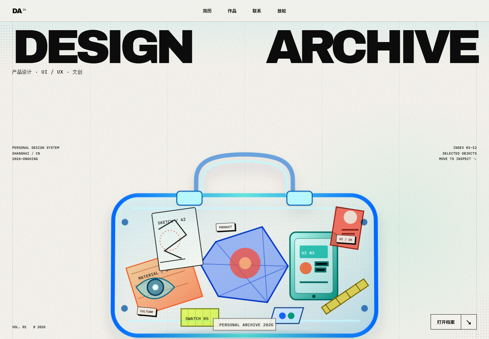

# Design Archive — Personal Portfolio

一个正在开发中的个人设计师作品集网站，覆盖产品设计、UI / UX 与文创设计。当前阶段先建立清晰的视觉语言、内容框架和交互原型，不提前填充真实项目。

> Outside = Personality / Inside = System

## 当前开发状态

状态：`Prototype / In Progress`

- [x] 实验性首页视觉与固定导航
- [x] X-Ray 安检包主视觉与分层透明素材
- [x] 横向安检传送带、扫描噪点和 Halftone 背景
- [x] 全屏作品索引框架与 Placeholder 项目
- [x] 简历 Archive / Editorial 框架
- [x] 极简联系页框架
- [x] 桌面端轻量视差、Hover 与 Reduced Motion 适配
- [ ] 首页桌面端最终视觉确认
- [ ] 移动端细节与多尺寸视觉校验
- [ ] 作品索引预览系统完善
- [ ] 真实项目内容与项目详情页
- [ ] 正式域名、性能优化与上线发布



## 设计主题

网站以个人档案与安检扫描为视觉母题，组合以下语言：

- Korean Experimental Editorial
- Personal Archive / Database
- Neo-Brutalist / Swiss Typography
- X-Ray / Transparent Object
- Halftone / Dot Matrix / Barcode / Scan / Mono

首页负责自由、彩色、实验性的 `Personality`；作品索引负责理性、黑白、编号化的 `System`。两部分通过字体、网格、标签、编号、扫描纹理与 Archive 体系统一。

## 技术与工具

- HTML5：语义化页面、Dialog 档案面板与可访问性结构
- CSS3：响应式网格、扫描纹理、Halftone、排版和动效
- Vanilla JavaScript：导航切换、视差、作品 Hover、上海时间显示
- PNG 透明素材：X-Ray 包体与内部物件分层
- Git / GitHub：版本管理、开发记录与展示
- Codex：协助代码维护、文档整理、检查与自动化

详细的设计原则、开发流程与目录说明见 [docs/DEVELOPMENT.md](./docs/DEVELOPMENT.md)。

## 本地预览

无需安装依赖，直接打开 `index.html` 即可。也可以在项目目录启动任意静态文件服务器：

```powershell
python -m http.server 8000
```

然后访问 `http://localhost:8000`。

## 每日记录

每天的开发内容、文件变更、验证结果与下一步会记录在 [`worklog/`](./worklog/) 中。自动整理只记录和提交项目内的工作文件，不上传缓存、临时文件或本地配置。

## 内容状态

当前作品、履历与联系方式均为结构占位。仓库用于展示视觉系统和开发进度，不代表最终作品集内容。

